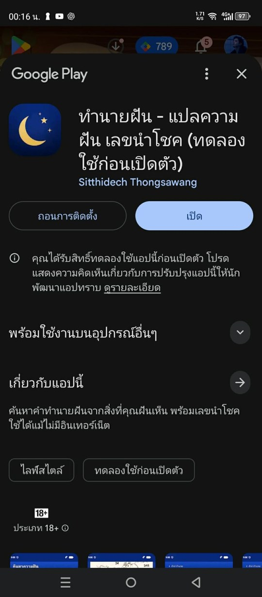
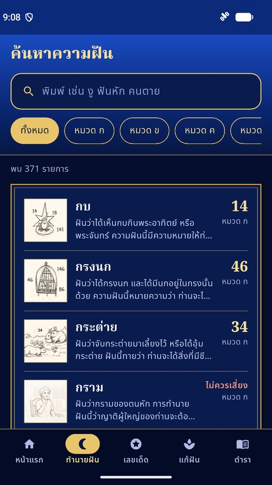
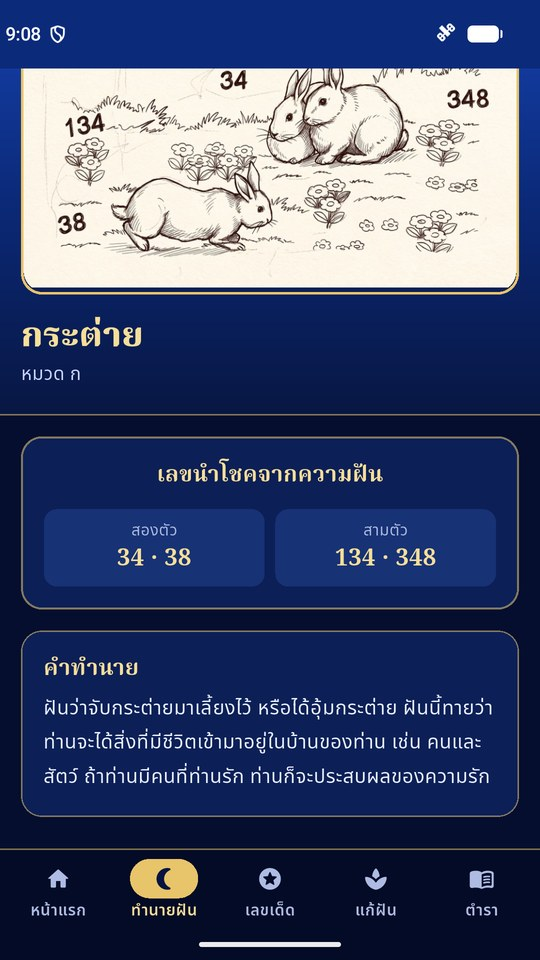
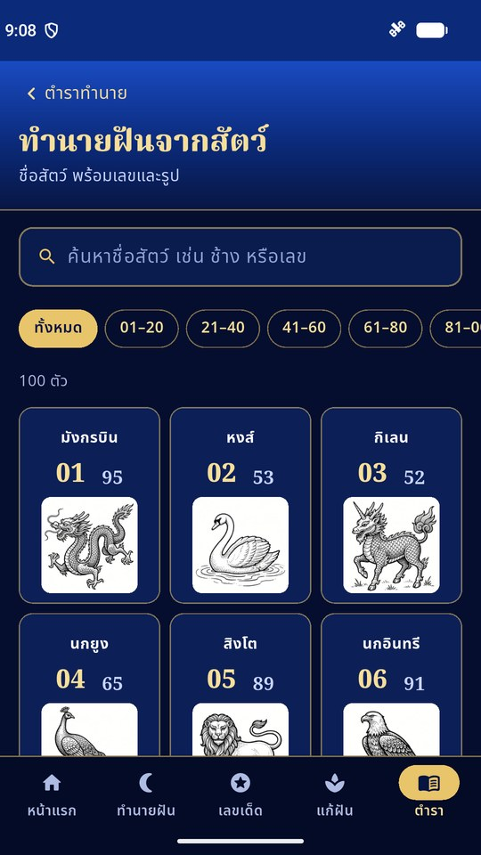
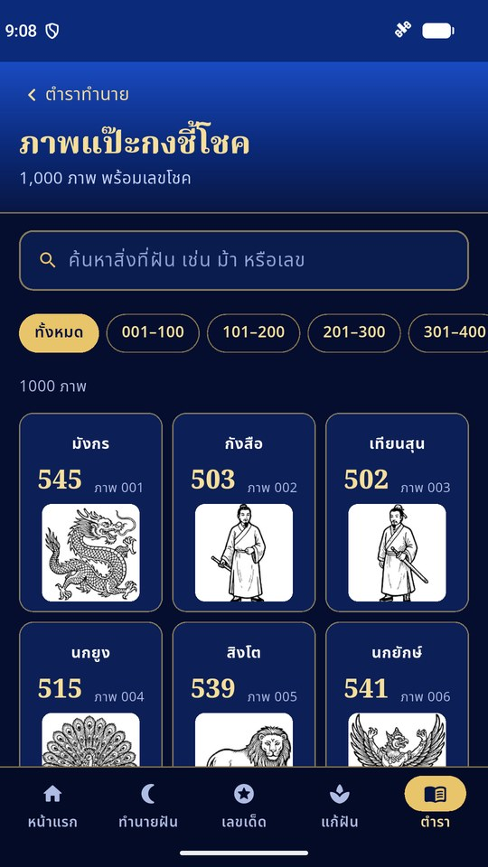
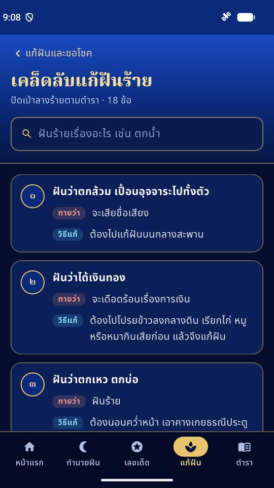
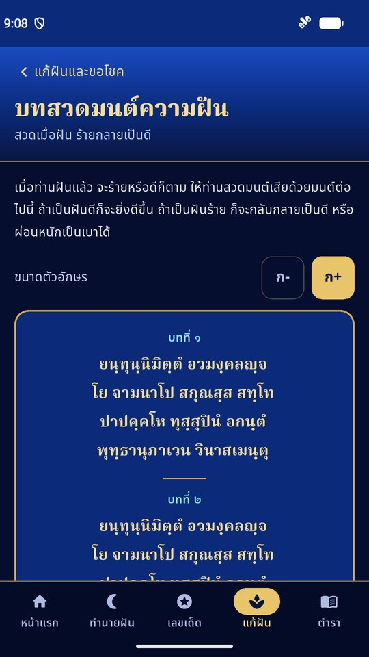
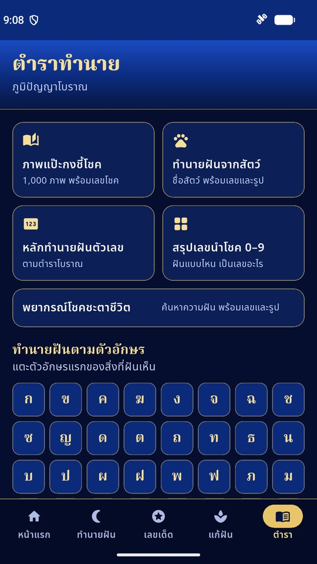

<p align="center">
  
</p>

<h1 align="center">ทำนายฝัน (Thamnai Fan) — Dream Interpretation App</h1>

<p align="center">
  A Thai dream-interpretation app for Android, built with Flutter.<br>
  Type what you dreamt about, read the interpretation — fully offline, no sign-up, no ads.
</p>

<p align="center">
  
  
  
  
  
</p>

> **Release status (November 2026):** version 1.0.0 passed Google's review and is live on the
> **Google Play closed-testing track**. It is now going through Google's required tester period
> (12 testers for 14 days) before the production launch. A store link will be added here once the
> app is public.

<p align="center">
  
</p>

<p align="center"><em>The app's Google Play page (early access), installed from the store on a real phone.</em></p>

> **About this repository:** this is a showcase. The app is a commercial product, so its source
> code and bundled content are kept in a private repository. I am happy to walk through the code in
> an interview.

---

## Demo

<p align="center">
  
</p>

<p align="center"><em>Full walkthrough of version 1.0.0 on a real Android phone, installed from Google Play: from app launch through every tab and menu (GIF plays at 2x speed).
<a href="images/demo.mp4">Watch at normal speed (MP4, about 2 minutes)</a></em></p>

## Screenshots

| Search | Interpretation | Animal book | Pae Kong pictures |
|:---:|:---:|:---:|:---:|
|  |  |  |  |

| Bad-dream remedies | Dream chant | Reference book |
|:---:|:---:|:---:|
|  |  |  |

---

## What the app does

People search by **what they saw in the dream** ("snake", "broken tooth", "a dead person") instead of
browsing a book page by page.

- **Dream search** — more than 370 interpretations from a traditional Thai dream book, searchable
  by keyword and browsable by Thai-alphabet category
- **Animal book** — 100 animals with pictures
- **Pae Kong pictures** — 1,000 illustrated entries
- **Number lore** — lucky numbers associated with each dream and the traditional meaning of digits 0–9
- **Remedies, rituals and a dream chant** — what tradition says to do after a bad dream
- **Dream of the day** — a different highlighted dream every day
- **Offline first** — all content ships inside the app; no account and no network needed
- **Accessible layout** — phones, foldables and tablets, and system font scaling up to 200%

The app is for entertainment and personal belief only. It has no betting, payment or
real-money feature of any kind.

---

## Tech stack

| Area | Details |
|---|---|
| App | Flutter 3.47, Dart 3.13, Material Design, custom dark-blue and gold theme |
| Fonts and language | Noto Sans Thai, Noto Serif Thai, Thai localization |
| Data | Bundled offline content behind a `DreamRepository` interface |
| Optional API mode | The same screens can read from a REST backend, switched by a compile-time setting |
| Backend (optional) | NestJS, Prisma, PostgreSQL, Docker |
| Crash reporting | Firebase Crashlytics |
| Testing | `flutter_test` unit and widget tests, golden tests, `integration_test` smoke test, Jest for the backend |
| CI | GitHub Actions: format check, static analysis, tests |
| Release | Signed Android App Bundle, Dart obfuscation, Play App Signing |

## Architecture

```text
lib/
├── main.dart            App start-up, crash reporting, configuration check
├── app_shell.dart       Bottom navigation and adaptive layout
├── theme.dart           Colors, typography, shared styles
├── data/                Content and repositories (offline data, optional API client)
├── state/               App controller, daily pick, load requests, error log
├── screens/             Home, search, result, menu and feature screens
└── widgets/             Shared UI components
```

Design decisions worth mentioning:

- **Repository pattern.** Screens depend on `DreamRepository`, not on where the data lives. The
  default implementation reads bundled content; an API implementation talks to the backend. Tests
  run against the same interface.
- **Fail loudly on bad configuration.** An invalid API address stops the app at start-up instead of
  silently falling back to sample data, and release builds refuse plain `http://`.
- **Search built for real input.** Search works on what users actually type, with Thai-alphabet
  categories as a second way in.
- **Adaptive layout.** One codebase covers small phones, large phones, folded and unfolded
  foldables, and tablets in both orientations.

---

## Quality

| Check | Result |
|---|---|
| Automated tests | About 600 unit and widget tests across 75 test files |
| Layout verification | 8 device sizes from a 360 × 640 phone to a 1280 × 800 tablet, plus 200% text scale |
| Pre-release audit | 32-item quality checklist covering content, search, layout, errors, accessibility and release setup |
| Static analysis | `flutter analyze` and `dart format` enforced in CI |
| Real-device test | Release build installed and tested on a physical Android 14 phone |

## Release process

1. Work lands on `serve_dev`, is merged into `uat` when tests pass, then into `prod` for release.
2. The release bundle is built from `prod`, signed with an upload key kept outside the repository,
   with Dart code obfuscated.
3. Google Play setup done for this app: store listing, privacy policy, data-safety form, content
   rating (IARC), target audience, and the closed-testing track.

| Milestone | Status |
|---|---|
| Feature complete, audit passed | Done |
| Signed release build 1.0.0 | Done |
| Google Play review for closed testing | Passed (16 Nov 2026) |
| Closed test: 12 testers for 14 days | In progress |
| Production release on Google Play | Next |

Privacy policy: <https://foam-01.github.io/thamnaifan-privacy/>

---

## My role

This is a solo project. I owned it end to end: the product idea and scope, content preparation,
UX decisions, architecture, testing strategy, the pre-release audit, and the whole Google Play
publishing process.

I worked with AI coding tools (Claude Code) throughout. I directed the work, reviewed and tested
the results, and made the product and release decisions. The illustrations and store graphics are
AI-generated and are declared as such on Google Play.

## สรุปภาษาไทย

**ทำนายฝัน** เป็นแอป Android สำหรับค้นหาคำทำนายฝันตามตำราไทย พัฒนาด้วย Flutter

- ค้นหาจากสิ่งที่ฝันเห็น มีคำทำนายกว่า 370 เรื่อง ตำราสัตว์ 100 ชนิด และภาพแป๊ะกง 1,000 ภาพ
- ใช้งานได้แบบออฟไลน์ ไม่ต้องสมัครสมาชิก ไม่มีโฆษณา
- รองรับมือถือ จอพับ แท็บเล็ต และการขยายตัวอักษรของเครื่อง
- มี automated test ประมาณ 600 รายการ และผ่านการตรวจคุณภาพ 32 ข้อก่อนปล่อย
- **สถานะ:** เวอร์ชัน 1.0.0 ผ่านการตรวจของ Google แล้ว อยู่ในขั้น closed testing บน Google Play
  และกำลังดำเนินการเพื่อเผยแพร่จริง (Production)
- ซอร์สโค้ดเก็บเป็น private เพราะเป็นผลิตภัณฑ์เชิงพาณิชย์ 

## Contact

GitHub: [@Foam-01](https://github.com/Foam-01) · Portfolio: <https://portfoliof-01.netlify.app/>
